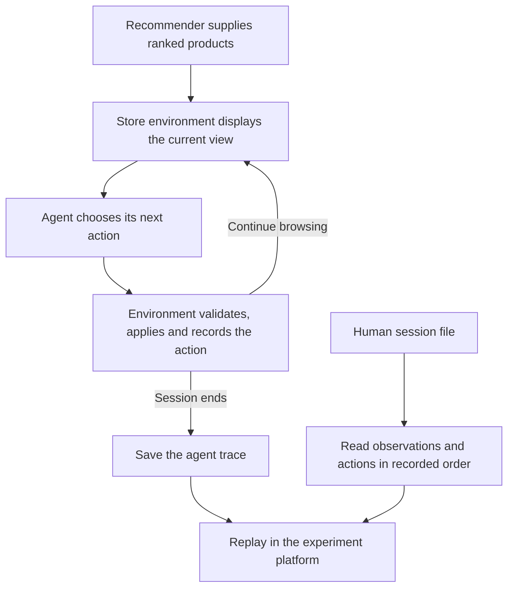

# Agent shopping simulation and trace replay design

[简体中文](DESIGN.zh-CN.md) · [Documentation](../../README.md)

**Design status:** Draft for review

## 1. Goal and scope

Given a user and the Original recommender, a researcher should be able to answer two questions. In what order did the model recommend products? Which products did the simulated shopper see, and what did it do? This iteration delivers a shopping session that researchers can inspect and replay step by step.

- Display the Original model’s ranked products in the order received.
- Let an agent browse, open details, rate an item or return to the list. Record each accepted action.
- Play agent sessions and externally recorded human sessions in the same workspace, with the source identified.

The Original model is sufficient for this iteration. Retrain and Unlearned comparisons, including experiments on whether users notice residual associations, belong to a later phase.

## 2. Workflow and approach

1. **Get and display the ranking.** The platform selects a user, the Original model and an action budget. The simulator requests one ranking and joins display information, such as names and images, by item ID. Keeping the initial order and scores makes it possible to reconstruct the choices available to the agent.
2. **Choose and execute an action.** The environment exposes the current view and prior executed actions. The policy chooses one action. The environment checks the target and the current screen before updating the list position, detail view, review or bag. A different policy can use the same shopping rules.
3. **Record and replay.** The environment records accepted actions in sequence. The integrated workflow will also record the item IDs in the viewport at each step. An agent exit or an exhausted action budget ends the session and records the reason. Replay reads the saved product snapshot and actions. Human replay reads each recorded action alongside the items visible *before* it. Missing screenshots or scroll distances are marked as missing. [UserArena data source](https://github.com/RecGPT-Team/UserArena) · [Data license](https://github.com/RecGPT-Team/UserArena/blob/main/LICENSE)

For example, the first two recommendations are a lamp and a mug. The agent opens the lamp and can return immediately or give it four stars and write a review. **Submitting the review keeps the lamp detail open.** Returning restores the previous list position so the shopper can inspect the mug. The four stars belong to the agent’s review. The model’s original recommendation score is retained separately.

## 3. Dependencies and handoffs

| Project module | Responsibility in this workflow | Handoff |
| --- | --- | --- |
| Data management (A) | Supplies stable user and item IDs, the data split and product metadata | Recommendation scores the right items, and simulation uses the same IDs to find their display records |
| Recommendation (A) | Loads the selected model and ranks products for the user | Simulation starts from the returned items, ranks and scores |
| Unlearning (B, later) | Produces retrained and unlearned model artifacts | Recommendation loads each artifact so simulation can repeat the workflow |
| Agent simulation (C) | Coordinates decisions, executes actions, updates the shopping state and records the session | The platform receives an ordered trace with its source for replay and later behavioral analysis |
| Static evaluation (C) | Computes recommendation quality and related metrics from model rankings and test data | The platform can show these metrics alongside the dynamic trace of the same experiment |
| Experiment platform | Starts runs, links models, settings, metrics and traces, and provides replay | Researchers can locate the records for a given run |

The [recommendation–simulation interface](../../interfaces/RECOMMENDATION_AGENT.md) specifies the handoff. Existing types follow the [shared contracts](../../contracts/INTERFACES.md). The [research protocol](../../research/SIMULATION_PROTOCOL.md) defines what the agent may observe.

## 4. Done for this iteration

| Status | Observable result |
| --- | --- |
| Foundation in the repository | Run a session with a test recommender and inspect the products shown and action taken at each step. The runner supports click, dislike, skip and exit. Selecting an item outside the displayed list raises an error. [Simulation runner](../../../backend/src/recforgetbench/simulation/runner.py) |
| Verified in the standalone shopping prototype | A rule-based agent opens an item from a sample ranking, rates it four stars and returns. Exporting and reimporting the trace reproduces the review for that item and the previous list position. |
| Verified in standalone human replay | Import a UserArena session and check the order of visible items and the click target against the record. Where available, inspect the source screenshot for that step. |
| Integration target | Start a session through the platform with a real user ID and the Original model. The initial list of item IDs matches the ranking. Retrieve the trace by run ID, check which items were in the viewport and reproduce the same actions and ratings. |

