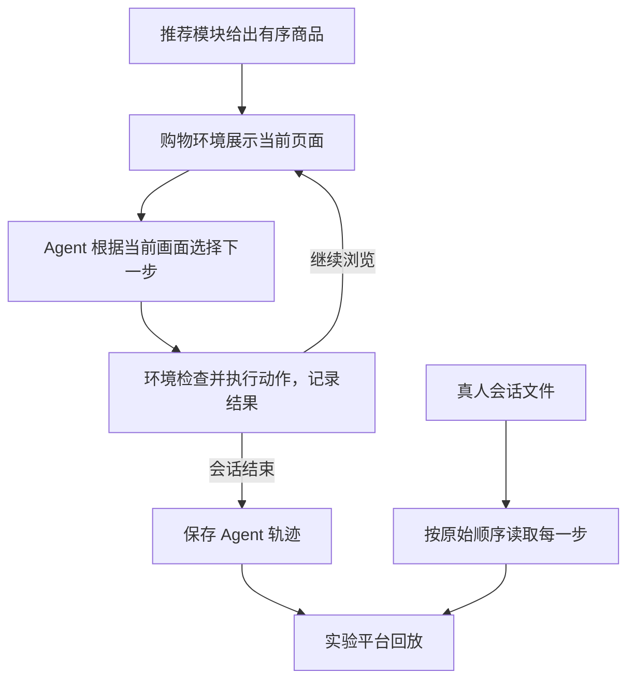

# Agent 购物模拟与轨迹回放设计方案

[English](DESIGN.md) · [文档目录](../../README.zh-CN.md)

**方案状态：** 草稿，待评审

## 1. 目标与范围

给定一个用户和原推荐模型（Original），我们要能回答两个问题：模型按什么顺序给他推荐了商品？模拟用户（Agent）实际看了什么、做了什么？本阶段交付一场可以逐步查看和回放的购物会话，后续评测可以据此比较不同模型下的用户行为。

- 接收原模型的推荐榜单，按模型给出的顺序展示商品。
- 让 Agent 在购物页面上逐步浏览、打开详情、评分或返回，记录每次生效的操作。
- 在同一工作台回放 Agent 会话和外部真人会话，标明各自来源。

首版只需要原模型。重训、遗忘模型的接入和“用户是否察觉遗忘”的判断留到对照实验阶段。

## 2. 整体流程与实现思路

1. **取榜并展示。** 平台选定用户、原模型和操作步数上限。模拟模块向推荐模块取一次榜单，用商品 ID 补上名称、图片等展示资料，保留原始名次和分数。一场会话固定这份榜单，便于回头查清 Agent 当时有哪些选择。
2. **选择并执行。** 环境提供当前画面及已执行的操作。Agent 策略每次选择一个动作，环境检查目标商品和页面是否匹配，再更新列表位置、详情、评价或购物袋。更换 Agent 时可替换决策策略，沿用相同的购物规则。
3. **记录并回放。** 环境按顺序记录生效动作。接入平台时，每步还要保存当时屏幕内的商品 ID。Agent 主动结束或达到步数上限时，保存轨迹和结束原因。回放只读取商品快照和已记录的动作。真人回放按原记录展示每一步动作前的画面，缺失的截图或滑动距离标为未记录。[UserArena 数据来源](https://github.com/RecGPT-Team/UserArena) · [数据许可](https://github.com/RecGPT-Team/UserArena/blob/main/LICENSE)

例如，榜单前两件是台灯和陶瓷杯。Agent 打开台灯，可以直接返回，也可以先打 4 星、写评论。**提交评价后仍停在台灯详情。** 选择返回时，列表恢复到打开台灯前的位置，可以接着看陶瓷杯。这里的 4 星是 Agent 的评价，模型给台灯的推荐分另行保留。

## 3. 模块依赖与对接

| 项目模块 | 在这条流程里负责什么 | 交给谁 |
| --- | --- | --- |
| 数据管理（A） | 提供用户和商品的稳定 ID、数据划分、商品资料 | 推荐模块用来识别用户和打分，模拟环境按相同 ID 找到商品 |
| 推荐模型（A） | 加载指定模型，给用户返回排好序的商品、名次和分数 | Agent 模拟模块按此榜单开始会话 |
| 遗忘算法（B，后续） | 产出重训或遗忘后的模型 | 推荐模块加载相应模型，模拟模块可重复同一流程 |
| Agent 模拟（C） | 组织 Agent 决策、执行动作、更新页面状态并记录会话 | 平台收到带来源的有序轨迹，供回放和后续行为分析 |
| 静态评测（C） | 用模型排名和测试集计算推荐质量等指标 | 平台汇总指标，可与同次实验的动态轨迹一起查看 |
| 实验平台 | 发起任务，关联模型、配置、指标和轨迹，提供回放入口 | 研究者可从一次运行找到对应记录 |

推荐方与模拟方的具体交接见[推荐与 Agent 接口约定](../../interfaces/RECOMMENDATION_AGENT.zh-CN.md)。公共类型沿用[共享协议](../../contracts/INTERFACES.md)，模拟观察范围遵循[研究协议](../../research/SIMULATION_PROTOCOL.md)。

## 4. 本阶段完成标准

| 进度 | 可以直接检查的结果 |
| --- | --- |
| 仓库已有基础 | 用测试推荐器运行一次会话，可看到每步展示的商品和动作。运行器支持点击、不喜欢、跳过和退出，选择未展示商品会报错。[模拟运行器](../../../backend/src/recforgetbench/simulation/runner.py) |
| 独立购物原型已验证 | 用示例榜单让规则 Agent 打开商品、打 4 星并返回。导出再导入记录，能还原同一件商品的评价与列表位置。 |
| 独立真人回放已验证 | 导入 UserArena 会话，逐步核对可见商品顺序和点击目标。有来源截图的步骤可直接对照。 |
| 本阶段待联调 | 平台用一个真实用户 ID 和原模型启动会话。初始列表的商品 ID 顺序与榜单一致。结束后按运行 ID 找回轨迹，可核对当时屏幕范围内的商品，并复现同一串动作和评分。 |
