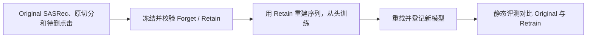

# 遗忘模块设计方案

V9 · 2026-11-25 · **方案状态：草稿**

[团队文档目录](https://github.com/zhang-haichao/AfterRec/blob/main/docs/README.zh-CN.md)

## 1. 目标与范围

接收一个已训练的 SASRec、其原始数据切分和需要遗忘的点击，生成可重载、可追溯的新模型。首轮完成 SASRec Retrain，由静态评测模块对比原模型（Original）与重训模型（Retrain）。

- **请求准备。** 按原始点击 ID 形成并冻结 Forget（待删）和 Retain（保留）清单。
- **方法执行。** 复用推荐模块的 SASRec，在 Retain 上从头训练，建立后续算法的对照基线。
- **模型交付。** 校验并登记新检查点、ID 映射和来源，供评测与平台使用。

下一步用同一个 Original 和同一份遗忘划分验证 SCIF。双塔和平台集成在后续阶段安排。

## 2. 整体流程与实现思路

1. **冻结请求。** B 从原 Train 校验待删点击，确认 Forget 与 Retain 互斥且合起来等于原 Train。记录原模型、数据版本、原切分和清单哈希，执行前复核。
2. **重建并训练。** 推荐模块按原模型的时间顺序、窗口和 ID 映射，从 Retain 重建历史及下一商品标签。用相同模型结构、新权重和新优化器训练，Valid、Test 的目标沿用原划分。例中同一用户在原 Train 依次点击 `I1 → I2 → I3 → I4`，历史窗口至少为 3。遗忘点击 `I2` 后，`[I1] → I2` 消失，`[I1, I2, I3] → I4` 变成 `[I1, I3] → I4`。B 根据原始点击 ID 核对历史和标签两侧。如果训练入口使用预生成的序列，也要基于 Retain 重新生成。 [RecBole 序列构造](https://github.com/RUCAIBox/RecBole/blob/v1.2.1/recbole/data/dataset/sequential_dataset.py) · [MIT 许可](https://github.com/RUCAIBox/RecBole/blob/v1.2.1/LICENSE)
3. **交付并对比。** B 验证新检查点可重载并打分，登记原模型、遗忘请求、实际训练输入和输出检查点。静态评测对两个模型使用相同的测试目标、历史、候选、过滤规则和 K。

本地 BPR 基线可复用请求冻结、清单校验和 Retrain 编排。首轮新增 SASRec 的 Retain 适配、训练输入审计与重载验证。后续 SCIF 从原检查点的副本出发，用删除前后受影响的样本和 Retain 更新部分参数。 [ERASE 的 SCIF 实现](https://github.com/deem-data/erase-bench/blob/42ea967ba56f9472cc0ea3b746f32e80153e1170/recbole/trainer/trainer.py#L3271)

## 3. 模块依赖与对接

- **数据管理 → B。** 提供有版本的点击数据和固定划分，能够按点击 ID 找到用户、商品、时间及同时间下的稳定顺序。
- **推荐模型 ↔ B。** 推荐模块提供 Original 检查点、配置和 ID 映射。B 交付 Retain 切分，推荐模块返回新检查点和实际训练输入记录，并提供重载与打分能力。 [推荐与遗忘接口](../../interfaces/RECOMMENDATION_UNLEARNING.md)
- **B → 静态评测、平台。** 交付 Original 和 Retrain 的模型引用及请求关联。静态评测负责计算指标，平台消费模型与运行记录。推荐与评测模块需确认怎样向两个 SASRec 模型提供同一份历史。 [模型与评测接口](https://github.com/zhang-haichao/AfterRec/blob/main/docs/interfaces/MODEL_EVALUATION.md) · [实验产物接口](https://github.com/zhang-haichao/AfterRec/blob/main/docs/interfaces/EXPERIMENT_ARTIFACTS.md)

## 4. 本阶段完成标准

1. 对同一原切分和冻结请求能复现 Forget/Retain。核对训练样本来源，所有待删点击均未进入重训历史或标签。
2. 能用 Retain 从头训练 SASRec，生成独立检查点，通过推荐模块重载并打分，同时核对 Original 检查点的哈希未变。
3. 能生成 Original 与 Retrain 的 Recall@K、NDCG@K 对照结果。两次评分使用同一评测协议，结果可回查模型、切分、遗忘请求和 K。指标记录推荐效用，数据删除由第 1 条的输入审计验证。

请求冻结和 Retrain 流程已有本地 BPR 小样本验证。以上三条是 SASRec 的待验收结果。
